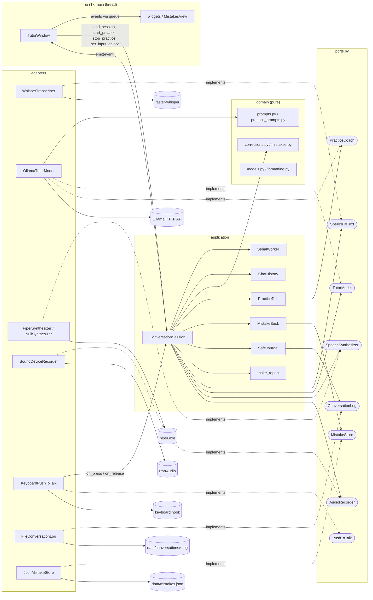
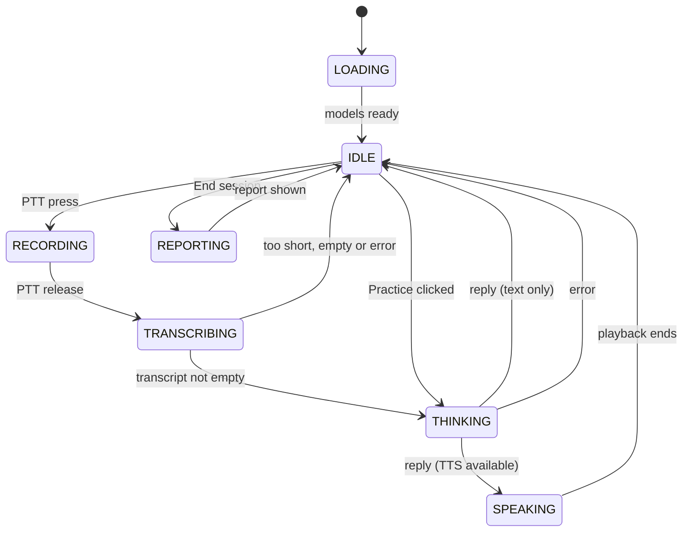

# Architecture

The application follows a ports-and-adapters (hexagonal) layout. Business rules and the conversation state machine depend only on small interfaces (ports); everything that touches hardware, the network, the file system or an external binary is an adapter plugged in at start-up.

All code lives in `src/english_tutor/`. Every source file is below about 400 lines.

## Layers

| Layer | Package / module | Contains | May import |
| --- | --- | --- | --- |
| Domain | `domain/` | Value objects, correction rules, mistake-history rules, prompts and JSON schemas, text formatting. Pure Python, no I/O | nothing else in the project |
| Ports | `ports.py` | `Protocol` interfaces, `AudioClip`, adapter exception types | domain |
| Audio helpers | `audio/` | Pure audio processing, microphone list and de-duplication | ports (for `AudioClip`) |
| Application | `application/` | `ConversationSession` (state machine), practice drill, mistake book, report builder, events, history, `SerialWorker` | domain, ports, `audio.processing` |
| Adapters | `adapters/` | Whisper, Ollama, Piper, sounddevice, keyboard, log file and JSON store implementations | domain, ports, config, `audio.devices` |
| UI | `ui/` | customtkinter window (container) and widgets (presentational) | application, domain, config |
| Config | `config.py` | `TUTOR_*` environment variables to an immutable `AppConfig` | standard library only |
| Composition root | `__main__.py` | Builds adapters, session and window, then runs the main loop | everything |

Dependencies point inwards: the application layer never imports an adapter, and `ui/widgets.py` and `ui/mistakes_view.py` do not import the application layer at all (they receive plain data and callbacks).

## Ports and adapters



Notes on the wiring:

- `PushToTalk` is satisfied by `KeyboardPushToTalk`, but the session does not hold a reference to it: the composition root registers `session.on_ptt_press` and `session.on_ptt_release` as its callbacks.
- `OllamaTutorModel` implements both `TutorModel` and `PracticeCoach`; the composition root passes the same instance for both (`tutor` and `coach=tutor`).
- The logging and mistake-history ports are optional: without them the session uses `NullConversationLog` and `NullMistakeStore` (`application/journal.py`).

## Module table

| File | Responsibility |
| --- | --- |
| `__main__.py` | Composition root. `main()` loads config (exit code 2 and a stderr message on `ConfigError`), configures logging, builds adapters (a `NullSynthesizer` when voice output is off or Piper is missing; `FileConversationLog` and `JsonMistakeStore` under `cfg.data_dir`), the session and the window, starts push-to-talk, runs `mainloop`, and shuts down |
| `config.py` | `AppConfig` (frozen dataclass, `ptt_label` property), `load_config`, `resolve_piper_exe`, `key_label`, `ConfigError`; range-checked numeric helpers |
| `ports.py` | Protocols `SpeechToText`, `TutorModel`, `PracticeCoach`, `SpeechSynthesizer`, `AudioRecorder`, `PushToTalk`, `ConversationLog`, `MistakeStore`; `AudioClip`; `LogSpeaker`; exceptions `AdapterError`, `LlmUnavailable`, `SttError`, `TtsError`, `StorageError` |
| `domain/models.py` | `Severity`, `SessionState`, `PracticeOutcome`, `Correction`, `TutorReply`, `PracticeReply`, `MistakeRecord`, `Turn`, `Transcript`, `ChatMessage`, `SessionFeedback`, `SessionReport` |
| `domain/corrections.py` | `normalize`, `is_cosmetic`, `filter_corrections`, `dedupe`, `pick_live`, `spoken_line` |
| `domain/mistakes.py` | Pure mistake-history rules: `mistake_key`, `add_corrections`, `add_practice`, `rank` (`MAX_EXAMPLES` = 3) |
| `domain/prompts.py` | `TURN_SYSTEM_PROMPT`, `REPORT_SYSTEM_PROMPT`, `TURN_SCHEMA`, `REPORT_SCHEMA`, `build_report_user_message` |
| `domain/practice_prompts.py` | `PRACTICE_SYSTEM_PROMPT`, `PRACTICE_SCHEMA`, `PRACTICE_START`, `build_practice_system_prompt` |
| `domain/formatting.py` | Plain-text renderings shared by the UI and the log: `format_report`, `correction_text`, `practice_speech` |
| `audio/processing.py` | `to_mono`, `resample` (polyphase), `peak_normalize`, `prepare_for_stt` |
| `audio/devices.py` | `InputDevice`, `dedupe_input_devices` (WASAPI > DirectSound > MME), `resolve_default`, `list_input_devices` |
| `application/session.py` | `ConversationSession`: PTT handling, turn pipeline, practice entry points, report, failure guard |
| `application/practice.py` | `PracticeDrill` (target + its own bounded history), `open_practice`, `run_practice_turn` |
| `application/mistake_book.py` | `MistakeBook`: in-memory mistake history backed by a `MistakeStore`; storage errors go to a warning callback |
| `application/journal.py` | `SafeJournal` (a conversation log whose failures warn instead of raising), `NullConversationLog`, `NullMistakeStore` |
| `application/report.py` | `collect_errors`, `make_report` (end-of-session report; feedback failures kept as text) |
| `application/events.py` | Event dataclasses sent to the UI: `StateChanged`, `UserSaid`, `TutorSaid`, `ReportReady`, `ErrorRaised`, `LevelChanged`, `MistakesChanged`, `PracticeChanged`, `PracticeFeedback` |
| `application/history.py` | `ChatHistory`: bounded memory of user/assistant pairs |
| `application/worker.py` | `SerialWorker` (one daemon thread, one job at a time) and `InlineRunner` (runs jobs on the caller's thread, for tests) |
| `adapters/whisper_stt.py` | `build_transcribe_kwargs`, `WhisperTranscriber` (lazy import, CUDA warm-up, CPU fallback) |
| `adapters/ollama_chat.py` | `OllamaTutorModel`: `check`, `reply`, `feedback`, `practice` over `/api/chat` with structured output |
| `adapters/ollama_parsing.py` | Tolerant JSON parsing of model answers (`parse_tutor_reply`, `parse_feedback`, `parse_practice_reply`); never raises |
| `adapters/piper_tts.py` | `PiperSynthesizer` (runs `piper.exe`, plays the WAV), `NullSynthesizer` |
| `adapters/sounddevice_recorder.py` | `SoundDeviceRecorder`: callback-mode input stream, level meter values |
| `adapters/keyboard_ptt.py` | `KeyboardPushToTalk`: global key hooks, ignores auto-repeat, filters the Left/Right side of Ctrl/Alt via `side_names` |
| `adapters/file_conversation_log.py` | `FileConversationLog`: one timestamped `.log` file per session |
| `adapters/json_mistake_store.py` | `JsonMistakeStore`: versioned `mistakes.json`, atomic save, corrupt-file backup |
| `ui/app_window.py` | `TutorWindow` (container): layout with Chat and Mistakes tabs, event queue and pump, enables/disables controls |
| `ui/widgets.py` | `ChatView`, `PracticeBanner`, `MicSelector`, `LevelMeter`, `StatusBar`, `ControlBar` (presentational) |
| `ui/mistakes_view.py` | `MistakesView`: ranked list of mistakes with a Practice button per row (first 50) |
| `ui/theme.py` | Colours, fonts, appearance mode |

Heavy libraries (`faster_whisper`, `sounddevice`, `keyboard`, `scipy.io.wavfile`) are imported lazily inside adapter methods, and `TutorWindow` is imported only after the configuration is valid. This keeps the tests free of hardware and lets configuration errors appear without loading Tk.

## Session states and practice mode

`SessionState` has seven values: `LOADING`, `IDLE`, `RECORDING`, `TRANSCRIBING`, `THINKING`, `SPEAKING`, `REPORTING`.



A press is accepted only in `IDLE`, a release only in `RECORDING`, and "End session" only in `IDLE`. Anything else is ignored, so overlapping recordings are impossible. The UI enables the **End session** button only while the state is `IDLE` and no drill is running.

Practice mode is not a separate state: it is a flag (`ConversationSession._drill`, a `PracticeDrill` or `None`) layered on top of the same states. `start_practice(key)` is accepted only in `IDLE` without a drill; it moves to `THINKING` ("Preparing practice...") and the drill is stored only after the coach answered. While a drill is set, `_process_turn` routes the transcript to the coach instead of the normal tutor, the ready message becomes `Practice: hold <KEY> to answer`, and `end_session` is ignored. `stop_practice()` (accepted in `IDLE` with a drill) clears the flag. If the coach fails to open the drill the session returns to `IDLE` still in conversation mode.

## Threading model

| Thread | Runs | Rules |
| --- | --- | --- |
| Tk main thread | `TutorWindow`, all widgets, `_pump`; also `start_practice` / `stop_practice` / `end_session` calls from buttons | The only thread that touches Tk |
| Keyboard hook thread (owned by the `keyboard` package) | `on_ptt_press`, `on_ptt_release` | Both only change the state and queue a job, so they return immediately. The microphone is **not** opened here |
| PortAudio callback thread | `SoundDeviceRecorder._callback` | Copies the chunk under a lock; every 3rd block computes a level (RMS x 15, capped at 1.0) and calls `on_level` |
| `tutor-worker` (`SerialWorker`, daemon) | Model loading, **opening and closing the microphone**, Whisper, Ollama, Piper playback, report, log writes, mistake-history load/save | One job at a time; the only thread that mutates `turns`, the history and the mistake book |

Because the worker is a FIFO queue, the job queued by a press (`_start_recording`) always runs before the job queued by the matching release (`_process_turn`). A quick tap ends with `Too short or too quiet, try again`, either because the start job was skipped (the release arrived first) or because the clip is shorter than 0.25 s; if opening the microphone fails, `Could not start recording: ...` is shown and the session returns to `IDLE`.

### Locks and shutdown

- `_lock` guards the state value, the drill flag and the `_closing` flag. `_recorder_lock` serialises `recorder.start` and `recorder.stop`, both of which now run on the worker (and `stop` from `shutdown`).
- **Lock order:** always `_recorder_lock` first, then `_lock`. Never take `_recorder_lock` while holding `_lock`.
- `_mic` (`closed` / `open` / `failed`) records whether the microphone was opened, so `stop` is only called on an open stream.
- `shutdown(timeout_s=2.0)` runs on the UI thread. It sets `_closing` (so a queued start job does nothing), then waits **at most 2 seconds** for `_recorder_lock`; if the worker is stuck in an audio-driver call, it logs `Audio device busy ...` and closes anyway instead of freezing the exit. Then it closes the worker.

### How UI updates are marshalled

The session never calls Tk. It calls an `EventSink` (`emit`) with immutable event objects. In `__main__.py` the sink forwards each event to `TutorWindow.post`, which only does `queue.Queue.put` and is therefore safe from any thread. The window drains the queue on the Tk thread every 30 ms:

```text
_pump():  get_nowait() until queue.Empty  ->  _dispatch(event)  ->  self.after(30, _pump)
```

`_dispatch` maps events to widgets: `StateChanged` updates the status line and the controls, `UserSaid` / `TutorSaid` add chat bubbles (plus the correction card), `ReportReady` adds the report, `ErrorRaised` adds a notice line, `LevelChanged` updates the meter, `MistakesChanged` rebuilds the Mistakes tab, `PracticeChanged` shows or hides the practice banner (and switches to the Chat tab), and `PracticeFeedback` adds the verdict bubble followed by the next question. Events emitted before the window exists are dropped by the sink.

Control enabling (`_refresh_controls`): **End session** and every **Practice** button need an idle session outside a drill; **Stop practice** needs only an idle session. Microphone selection is handled on the Tk thread (`_on_mic_change` calls `session.set_input_device`). Closing the window calls `session.shutdown()` and then `destroy()`.

## Failure recovery

The rule: a job on the worker never leaves the session stuck in a busy state.

- `ConversationSession._submit` wraps every job in a guard. Any unexpected exception is logged, shown as `Unexpected error: ...` and the state is set back to `IDLE` (`_fail`).
- The expected failures are handled where they happen and also end in `IDLE`: the microphone could not start or stop, transcription failed, Ollama unreachable or timed out (the turn is not saved; a failed practice call leaves the drill and its history unchanged), unparseable model output (parsed leniently, never raises), TTS errors (logged; the reply is already on screen, so the turn continues text-only).
- `SerialWorker._loop` additionally catches anything a job raises so the worker thread stays alive.
- `end_session` still produces a report when feedback generation fails: recorded errors are shown and the failure text goes into `feedback_error`.

**Storage failures never block a turn.** Conversation-log writes go through `SafeJournal` and mistake-history saves through `MistakeBook`; both catch every exception, write a console warning each time, and tell the learner **once per source** per run (`Conversation log unavailable: ...` or the mistake-history message) through `ErrorRaised`. The turn continues, and the in-memory mistake history stays correct for the run. An unreadable `mistakes.json` is backed up and replaced by an empty history (see [configuration.md](configuration.md#mistake-history)). The mistake history is loaded on the worker at the start of `_load`, before Whisper.

One deliberate exception to "always IDLE": if the speech model cannot be loaded at start-up (`_load` catches the error and emits `Speech model failed to load: ...`), the state stays `LOADING` and no recording is possible until the app is restarted. A failed Ollama check or missing Piper only produces warnings and the app still reaches `IDLE`.
