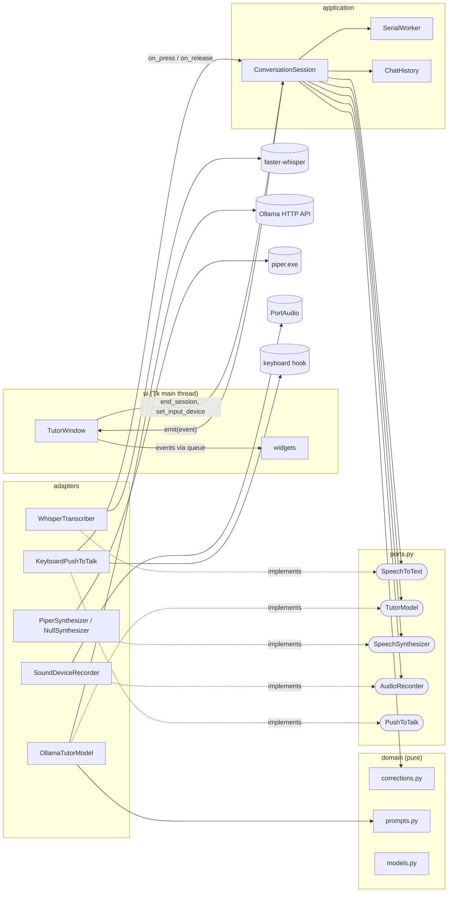
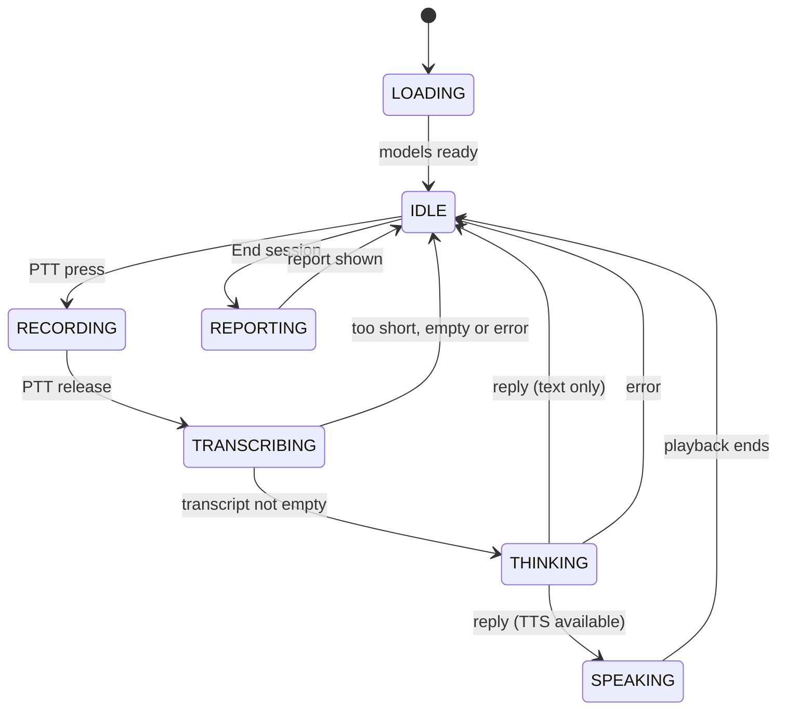

# Architecture

The application follows a ports-and-adapters (hexagonal) layout. Business rules and the conversation state machine depend only on small interfaces (ports); everything that touches hardware, the network or an external binary is an adapter plugged in at start-up.

All code lives in `src/english_tutor/`. Every source file is below about 400 lines.

## Layers

| Layer | Package / module | Contains | May import |
| --- | --- | --- | --- |
| Domain | `domain/` | Value objects, correction rules, prompts and JSON schemas. Pure Python, no I/O | nothing else in the project |
| Ports | `ports.py` | `Protocol` interfaces, `AudioClip`, adapter exception types | domain |
| Audio helpers | `audio/` | Pure audio processing, microphone list and de-duplication | ports (for `AudioClip`) |
| Application | `application/` | `ConversationSession` (state machine), events, history, `SerialWorker` | domain, ports, `audio.processing` |
| Adapters | `adapters/` | Whisper, Ollama, Piper, sounddevice, keyboard implementations | domain, ports, config, `audio.devices` |
| UI | `ui/` | customtkinter window (container) and widgets (presentational) | application, domain, config |
| Config | `config.py` | `TUTOR_*` environment variables to an immutable `AppConfig` | standard library only |
| Composition root | `__main__.py` | Builds adapters, session and window, then runs the main loop | everything |

Dependencies point inwards: the application layer never imports an adapter, and `ui/widgets.py` does not import the application layer at all (it receives plain data and callbacks).

## Ports and adapters



`PushToTalk` is satisfied by `KeyboardPushToTalk`, but the session does not hold a reference to it: the composition root registers `session.on_ptt_press` and `session.on_ptt_release` as its callbacks.

## Module table

| File | Responsibility |
| --- | --- |
| `__main__.py` | Composition root. `main()` loads config (exit code 2 and a stderr message on `ConfigError`), configures logging, builds adapters (a `NullSynthesizer` when voice output is off or Piper is missing), the session and the window, starts push-to-talk, runs `mainloop`, and shuts down |
| `config.py` | `AppConfig` (frozen dataclass), `load_config`, `resolve_piper_exe`, `ConfigError` |
| `ports.py` | Protocols `SpeechToText`, `TutorModel`, `SpeechSynthesizer`, `AudioRecorder`, `PushToTalk`; `AudioClip`; exceptions `AdapterError`, `LlmUnavailable`, `SttError`, `TtsError` |
| `domain/models.py` | `Severity`, `SessionState`, `Correction`, `TutorReply`, `Turn`, `Transcript`, `ChatMessage`, `SessionFeedback`, `SessionReport` |
| `domain/corrections.py` | `normalize`, `is_cosmetic`, `filter_corrections`, `dedupe`, `pick_live`, `spoken_line` |
| `domain/prompts.py` | `TURN_SYSTEM_PROMPT`, `REPORT_SYSTEM_PROMPT`, `TURN_SCHEMA`, `REPORT_SCHEMA`, `build_report_user_message` |
| `audio/processing.py` | `to_mono`, `resample` (polyphase), `peak_normalize`, `prepare_for_stt` |
| `audio/devices.py` | `InputDevice`, `dedupe_input_devices` (WASAPI > DirectSound > MME), `resolve_default`, `list_input_devices` |
| `application/session.py` | `ConversationSession`: PTT handling, turn pipeline, report, failure guard |
| `application/events.py` | Event dataclasses sent to the UI: `StateChanged`, `UserSaid`, `TutorSaid`, `ReportReady`, `ErrorRaised`, `LevelChanged` |
| `application/history.py` | `ChatHistory`: bounded memory of user/assistant pairs |
| `application/worker.py` | `SerialWorker` (one daemon thread, one job at a time) and `InlineRunner` (runs jobs on the caller's thread, for tests) |
| `adapters/whisper_stt.py` | `build_transcribe_kwargs`, `WhisperTranscriber` (lazy import, CUDA warm-up, CPU fallback) |
| `adapters/ollama_chat.py` | `OllamaTutorModel`: `check`, `reply`, `feedback` over `/api/chat` with structured output |
| `adapters/ollama_parsing.py` | Tolerant JSON parsing of model answers; never raises |
| `adapters/piper_tts.py` | `PiperSynthesizer` (runs `piper.exe`, plays the WAV), `NullSynthesizer` |
| `adapters/sounddevice_recorder.py` | `SoundDeviceRecorder`: callback-mode input stream, level meter values |
| `adapters/keyboard_ptt.py` | `KeyboardPushToTalk`: global key hooks, ignores auto-repeat |
| `ui/app_window.py` | `TutorWindow` (container): builds the layout, owns the event queue and pump |
| `ui/widgets.py` | `ChatView`, `MicSelector`, `LevelMeter`, `StatusBar`, `ControlBar` (presentational) |
| `ui/theme.py` | Colours, fonts, appearance mode |

Heavy libraries (`faster_whisper`, `sounddevice`, `keyboard`, `scipy.io.wavfile`) are imported lazily inside adapter methods, and `TutorWindow` is imported only after the configuration is valid. This keeps the tests free of hardware and lets configuration errors appear without loading Tk.

## Session states

`SessionState` has seven values: `LOADING`, `IDLE`, `RECORDING`, `TRANSCRIBING`, `THINKING`, `SPEAKING`, `REPORTING`.



A press is accepted only in `IDLE`, a release only in `RECORDING`, and "End session" only in `IDLE`. Anything else is ignored, so overlapping recordings are impossible. The UI enables the **End session** button only while the state is `IDLE`.

## Threading model

| Thread | Runs | Rules |
| --- | --- | --- |
| Tk main thread | `TutorWindow`, all widgets, `_pump` | The only thread that touches Tk |
| Keyboard hook thread (owned by the `keyboard` package) | `on_ptt_press`, `on_ptt_release` | Press starts the recorder; release only changes the state and queues a job, so it returns immediately |
| PortAudio callback thread | `SoundDeviceRecorder._callback` | Copies the chunk under a lock; every 3rd block computes a level (RMS x 15, capped at 1.0) and calls `on_level` |
| `tutor-worker` (`SerialWorker`, daemon) | Model loading, `recorder.stop`, Whisper, Ollama, Piper playback, report | One job at a time; the only thread that mutates `turns` and the history |

Locks inside `ConversationSession`: `_lock` guards the state value, `_recorder_lock` serialises `recorder.start` (hook thread) against `recorder.stop` (worker).

### How UI updates are marshalled

The session never calls Tk. It calls an `EventSink` (`emit`) with immutable event objects. In `__main__.py` the sink forwards each event to `TutorWindow.post`, which only does `queue.Queue.put` and is therefore safe from any thread. The window drains the queue on the Tk thread every 30 ms:

```text
_pump():  get_nowait() until queue.Empty  ->  _dispatch(event)  ->  self.after(30, _pump)
```

`_dispatch` maps events to widgets: `StateChanged` updates the status line and the button, `UserSaid` / `TutorSaid` add chat bubbles (plus the correction card), `ReportReady` adds the report, `ErrorRaised` adds a notice line, `LevelChanged` updates the meter. Events emitted before the window exists are dropped by the sink.

Microphone selection is handled on the Tk thread (`_on_mic_change` calls `session.set_input_device`). Closing the window calls `session.shutdown()` (stops a running recording, closes the worker) and then `destroy()`.

## Failure recovery

The rule: a job on the worker never leaves the session stuck in a busy state.

- `ConversationSession._submit` wraps every job in a guard. Any unexpected exception is logged, shown as `Unexpected error: ...` and the state is set back to `IDLE` (`_fail`).
- The expected failures are handled where they happen and also end in `IDLE`: recording could not stop, transcription failed, Ollama unreachable or timed out (the turn is not saved), unparseable model output (parsed leniently, never raises), TTS errors (logged; the reply is already on screen, so the turn continues text-only).
- `on_ptt_press` returns to `IDLE` if the recorder cannot start.
- `SerialWorker._loop` additionally catches anything a job raises so the worker thread stays alive.
- `end_session` still produces a report when feedback generation fails: recorded errors are shown and the failure text goes into `feedback_error`.

One deliberate exception: if the speech model cannot be loaded at start-up (`_load` catches the error and emits `Speech model failed to load: ...`), the state stays `LOADING` and no recording is possible until the app is restarted. A failed Ollama check or missing Piper only produces warnings and the app still reaches `IDLE`.
