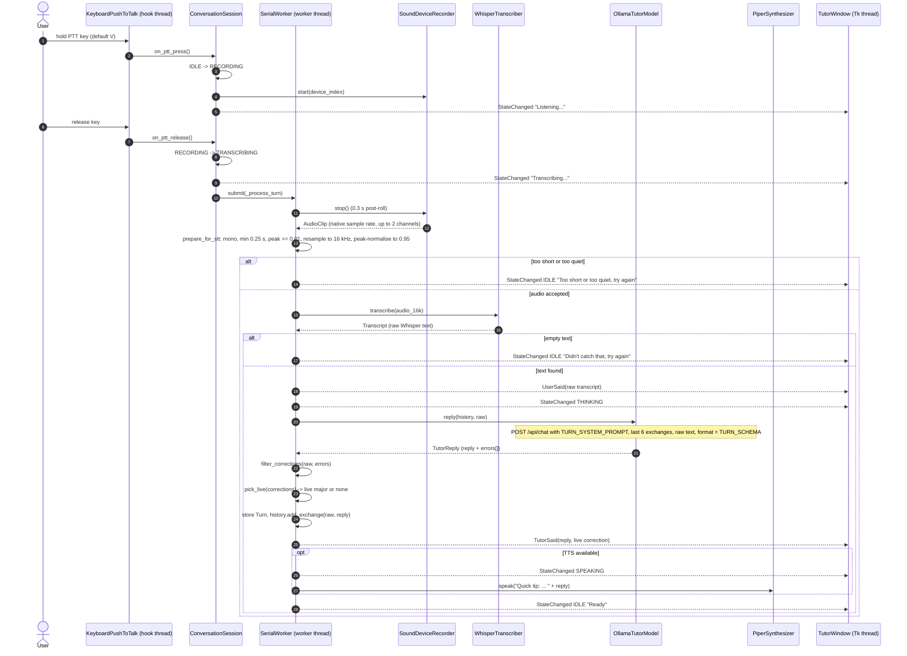
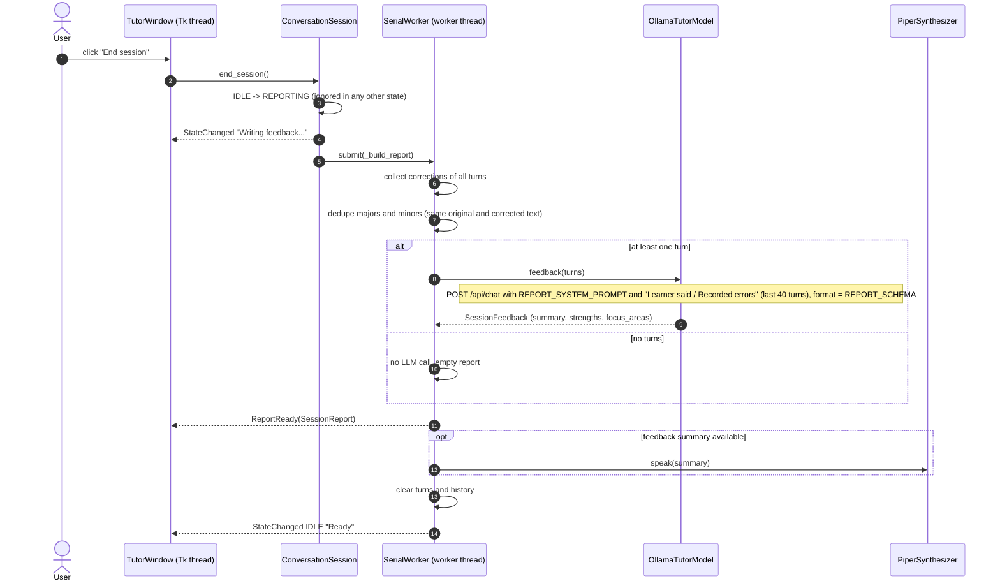

# Data flow

This page follows the data through the application for the two main use cases. For the structure behind it see [architecture.md](architecture.md); for the rules applied to corrections see [tutor-behavior.md](tutor-behavior.md).

## One conversation turn

Step notes:

- **Raw transcript.** `Transcript.text` is joined from the Whisper segments and stripped, nothing more. The same string goes to the chat bubble (`UserSaid`), to `Turn.user_text`, to the language-model request and to the history.
- **Request payload** (`OllamaTutorModel._chat`): `model`, `messages` (system prompt, history, user text), `stream: false`, `format` (the JSON schema), `options` (`temperature`, `num_ctx: 4096`) and `keep_alive: "10m"`. Timeouts are 5 s to connect and `TUTOR_OLLAMA_TIMEOUT` seconds to read.
- **Parsing.** The answer is parsed leniently: strict JSON first, then the first balanced `{...}` object, then the raw text as the reply with no corrections. Individual invalid error items are skipped.
- **Memory.** The history stores the learner's raw text and only the tutor's `reply` string (not the JSON, not the correction). It keeps the last `TUTOR_HISTORY_EXCHANGES` pairs (default 6); `0` disables memory.
- **Spoken text.** When there is a live correction, the spoken text is `Quick tip: instead of '<original>', say '<corrected>'.` followed by the reply. The chat shows the reply bubble and, after it, a separate correction card.
- **Failure branches.** If Ollama is unreachable or times out, `ErrorRaised` is emitted, the state returns to `IDLE` and the turn is not stored (the learner's bubble stays on screen). Transcription or recording errors behave the same way. See [architecture.md](architecture.md#failure-recovery).
- **Level meter.** While recording, the PortAudio callback sends `LevelChanged` events directly to the window queue (not through the worker).

## End-of-session report

Step notes:

- `SessionReport` carries `turn_count`, the deduplicated `major_errors` and `minor_errors`, the `feedback` and, if feedback generation failed, a `feedback_error` text. The recorded errors are shown even when the feedback call fails.
- The report text in the chat has the sections `Major errors`, `Minor errors` (each line `"original" -> "corrected" (explanation)`), then `Feedback:` with the summary, `+` lines for strengths and `> Focus on:` lines for focus areas.
- Only the summary is spoken. After the report the turns and the history are cleared, so the next conversation starts fresh.
- With zero turns the chat shows `No turns were recorded in this session.`
