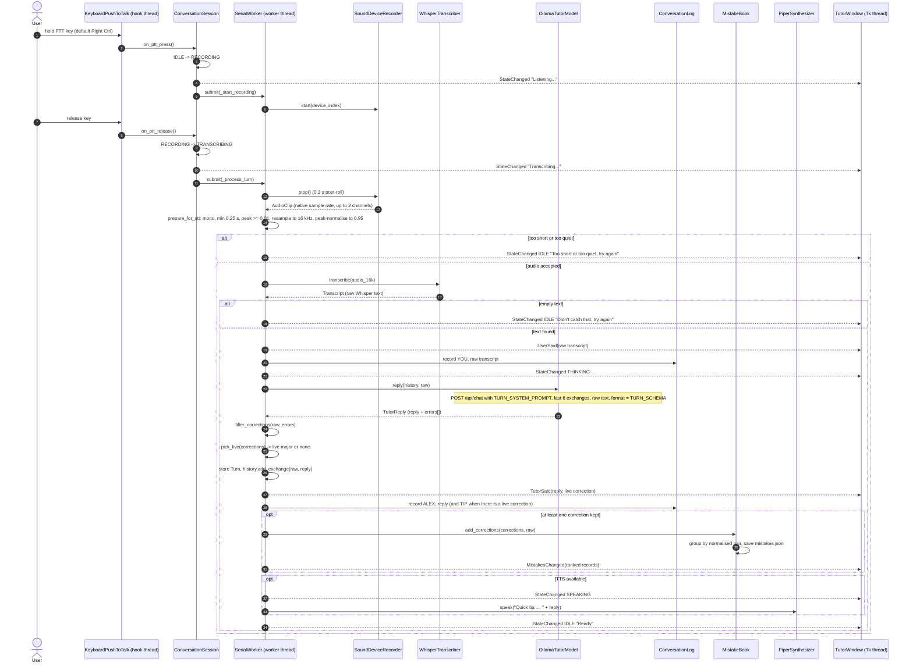
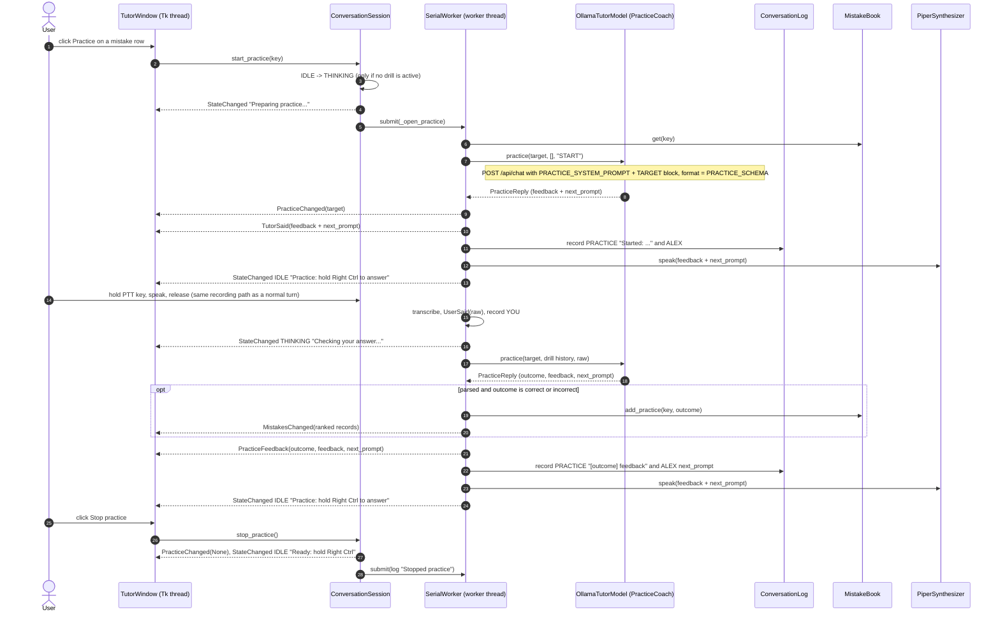
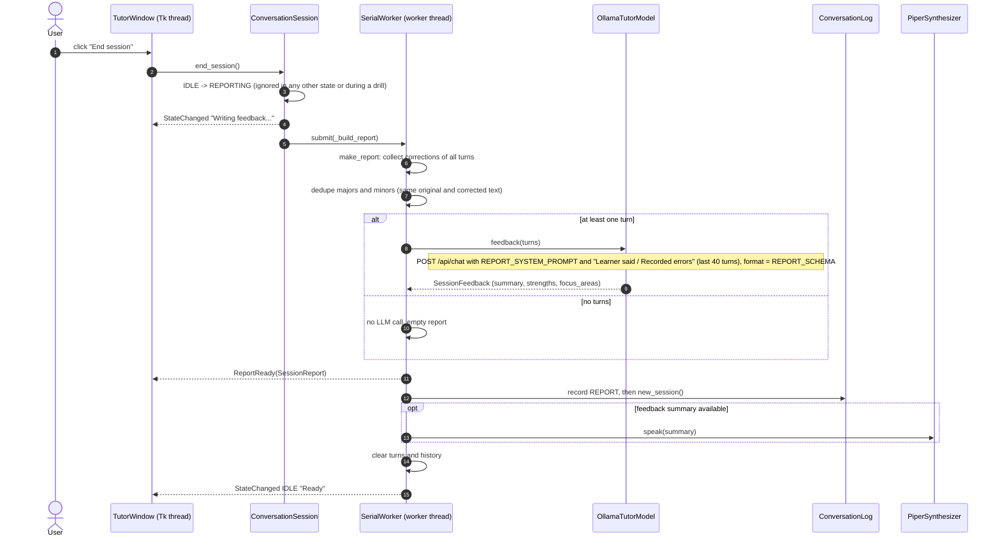

# Data flow

This page follows the data through the application for the main use cases. For the structure behind it see [architecture.md](architecture.md); for the rules applied to corrections see [tutor-behavior.md](tutor-behavior.md).

## One conversation turn

Step notes:

- **Microphone on the worker.** The key-hook thread only flips the state and queues jobs. Opening the microphone (`_start_recording`) and closing it (`_process_turn`) both run on the worker, in queue order. If the release arrives before the start job runs, the start is skipped and the turn ends with `Too short or too quiet, try again`. If opening fails, `Could not start recording: ...` is shown and the state returns to `IDLE`.
- **Raw transcript.** `Transcript.text` is joined from the Whisper segments and stripped, nothing more. The same string goes to the chat bubble (`UserSaid`), the log (`YOU`), `Turn.user_text`, the language-model request, the history and the mistake examples.
- **Logging.** The `YOU` line is written before the tutor is called, so it exists even if Ollama fails. Log and mistake-history failures are caught: they produce a one-time notice and a console warning, never a failed turn.
- **Mistake update.** Every correction that survived `filter_corrections` (major and minor, not just the live one) is counted in the mistake book, which saves `data/mistakes.json` atomically and sends `MistakesChanged` so the Mistakes tab refreshes.
- **Request payload** (`OllamaTutorModel._chat`): `model`, `messages` (system prompt, history, user text), `stream: false`, `format` (the JSON schema), `options` (`temperature`, `num_ctx: 4096`) and `keep_alive: "10m"`. Timeouts are 5 s to connect and `TUTOR_OLLAMA_TIMEOUT` seconds to read.
- **Parsing.** The answer is parsed leniently: strict JSON first, then the first balanced `{...}` object, then the raw text as the reply with no corrections. Individual invalid error items are skipped.
- **Memory.** The history stores the learner's raw text and only the tutor's `reply` string (not the JSON, not the correction). It keeps the last `TUTOR_HISTORY_EXCHANGES` pairs (default 6); `0` disables memory.
- **Spoken text.** When there is a live correction, the spoken text is `Quick tip: instead of '<original>', say '<corrected>'.` followed by the reply. The chat shows the reply bubble and, after it, a separate correction card.
- **Failure branches.** If Ollama is unreachable or times out, `ErrorRaised` is emitted, the state returns to `IDLE` and the turn is not stored (the learner's bubble and log line remain). Transcription or recording errors behave the same way. See [architecture.md](architecture.md#failure-recovery).
- **Level meter.** While recording, the PortAudio callback sends `LevelChanged` events directly to the window queue (not through the worker).

## One practice turn

Practice starts from the Mistakes tab. The drill has its own bounded history (4 exchanges) and uses a different system prompt ([tutor-behavior.md](tutor-behavior.md#practice-mode)).

Step notes:

- Recording, Whisper and the log line for the learner's answer are identical to a normal turn; the difference starts after `UserSaid`: the transcript goes to `practice()` instead of `reply()`.
- The normal correction pipeline is skipped: no `filter_corrections`, no `Turn` is stored, the normal chat history is not touched, nothing is added to the session report, and no new mistakes are recorded from a practice answer.
- The drill history stores each answer together with the spoken feedback and next question. A failed coach call leaves it unchanged and the drill stays active.
- An unparseable coach answer is treated as `not_used` with the raw text as the next question, and does not change the practice score.
- In the chat, the verdict appears as `Correct! <feedback>` or `Try again: <feedback>` (or the plain feedback for `not_used`), followed by the next question as a tutor bubble.

## End-of-session report

Step notes:

- `SessionReport` carries `turn_count`, the deduplicated `major_errors` and `minor_errors`, the `feedback` and, if feedback generation failed, a `feedback_error` text. The recorded errors are shown even when the feedback call fails.
- The report is built from the session's conversation turns only, so practice answers never appear in it.
- The report text in the chat has the sections `Major errors`, `Minor errors` (each line `"original" -> "corrected" (explanation)`), then `Feedback:` with the summary, `+` lines for strengths and `> Focus on:` lines for focus areas. The same text is written to the log under `REPORT`.
- `new_session()` makes the next logged entry start a new `.log` file.
- Only the summary is spoken. After the report the turns and the chat history are cleared, so the next conversation starts fresh. The persistent mistake history is **not** cleared.
- With zero turns the chat shows `No turns were recorded in this session.`
